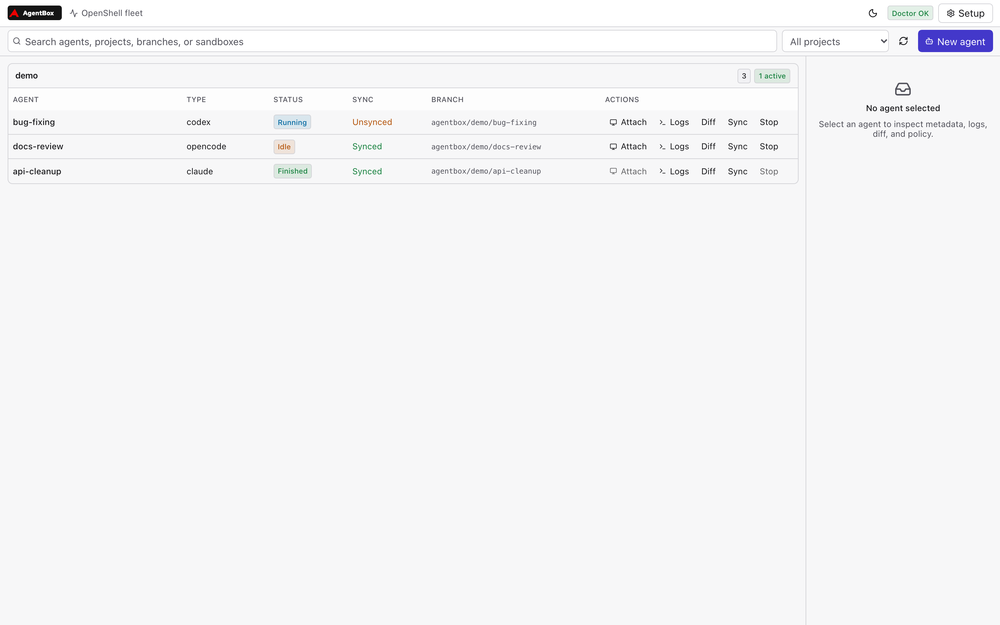
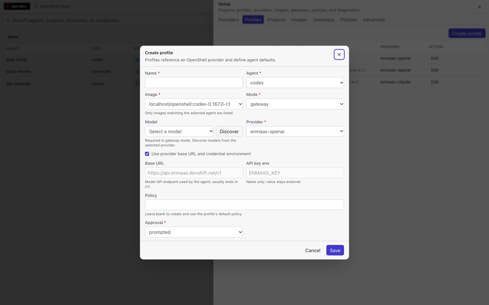

<p align="center">
  
</p>

# AgentBox

AgentBox is a local CLI and web GUI for running multiple coding agents in isolated OpenShell sandboxes. It manages OpenShell-backed images, gateway policies, providers, and concurrent agent runs while keeping each run’s checkout, state, logs, and configuration separate.

This repository is an autonomous OpenShell spike. It is not a supported product release.

## Screenshots

The screenshots use sample data.

<p align="center">
  
  
</p>

<p align="center">
  
</p>

## Documentation

- [OpenShell integration architecture](docs/openshell-architecture.md) — how images, providers, profiles, policies, and runs fit together.
- [AGENTS.md](AGENTS.md) — operating instructions and scope guardrails for AI agents contributing to this repository.

## Status

The current implementation provides:

- `doctor` checks for Go, Git, Podman, OpenShell, and gateway connectivity.
- `image` commands for version discovery, builds, listing, pushing, and pulling.
- `gateway` commands for listing, connecting, starting, and inspecting gateways.
- `provider` setup for OpenShell inference providers.
- `policy` commands for showing and editing sandbox policies.
- `agent` commands for start, list, show, attach, logs, stop, sync, diff, and delete.
- A compact React web GUI for the consolidated agent fleet and setup workflows.

Unit tests cover the core behavior with temporary repositories and fake command runners. Live OpenShell, registry, policy-enforcement, and real-agent checks are opt-in and documented below.

## Install

### Go install

Requires Go 1.26 or newer:

```sh
go install github.com/dmartinol/agentbox/cmd/agentbox@latest
```

Ensure Go's binary directory is on `PATH`:

```sh
export PATH="$(go env GOPATH)/bin:$PATH"
```

### GitHub Releases

Download the archive for the current platform from:

```text
https://github.com/dmartinol/agentbox/releases
```

Release archives include the `agentbox` binary, README, and license, plus a `checksums.txt` file for verification.

### First run

```sh
agentbox doctor
agentbox gui
```

## Live integration tests

The default test suite uses fake external commands. Live OpenShell checks are opt-in:

```sh
make test-live
```

Optional variables:

```sh
AGENTBOX_LIVE_GATEWAY=openshell
AGENTBOX_LIVE_SOURCE=/path/to/a/git/repo
AGENTBOX_LIVE_PROFILE=my-profile
AGENTBOX_LIVE_RUN=run-abc123
```

The live suite checks:

- `doctor` dependencies and gateway connectivity
- Podman exposure from the active gateway
- at least one AgentBox image and r3 metadata for all built-in agents
- real profile validation and a launch preview when `AGENTBOX_LIVE_PROFILE` is set
- run state, base/effective policy, and loaded policy revision when `AGENTBOX_LIVE_RUN` is set
- live policy allow/deny behavior when a sandbox network binary is available
- a complete real run lifecycle when `AGENTBOX_LIVE_NEW_RUN=1` is set
- concurrent runs when `AGENTBOX_LIVE_CONCURRENT_PROFILES` is set
- registry push/pull when `AGENTBOX_LIVE_LOCAL_IMAGE` and `AGENTBOX_LIVE_REGISTRY_REF` are set
- a secret scan of the live state directory when `gitleaks` is installed

See [IT01-REPORT.md](IT01-REPORT.md) for the current live feasibility result.

## Runtime prerequisites

The installed binary still requires:

- Git
- Podman
- OpenShell CLI
- An OpenShell gateway
- For image builds: Node.js and npm

## Build from source

```sh
make build
```

This creates an `agentbox` binary in the repository root. The binary embeds the compiled GUI in `internal/gui/web/dist`, so installing or building the Go binary does not require npm.

GUI development requires Node.js 22 or newer:

```sh
make web-build
make web-test
```

## Test

```sh
make test
make vet
make race
```

The Go suite covers the API server and application behavior. The GUI suite uses Vitest and Testing Library to cover navigation, page layout, filters, status presentation, forms, API error handling, and the aggregated project/agent tree.

## Usage

Run the doctor command to inspect local prerequisites:

```sh
./agentbox doctor
./agentbox doctor --json
```

Discover the latest supported Codex version:

```sh
./agentbox image versions codex
```

Build an image with a pinned version:

```sh
./agentbox image build --version 0.167.0 codex
```

Image build help and command discovery:

```sh
./agentbox image --help
./agentbox image build --help
```

If `--version` is omitted, AgentBox discovers and uses the latest compatible release for the selected agent. In the GUI build dialog, **Discover latest** queries npm and fills the exact version field so it can be inspected before building. The build pins the Node base image by digest and tags the result as `localhost/openshell:<agent>-<version>-r3`.

Configure an external image registry:

```sh
./agentbox image registry set quay.io/dmartino/openshell
./agentbox image registry discover
./agentbox image registry discover --json
./agentbox image registry push localhost/openshell:codex-0.167.0-r3
./agentbox image registry show --json
./agentbox image registry clear
```

The registry setting is stored in the private AgentBox state directory. Discovery and push/pull use Podman's existing registry login. In the GUI, open **Images → Registry** to set the registry and discover tags.

### Registry image model

One registry repository holds all AgentBox agent images. The agent, version, recipe, and architecture are encoded in the tag:

```text
<registry>/<namespace>/<project>:<agent>-<version>-r<recipe>-<os>-<arch>
```

Example:

```text
quay.io/dmartino/openshell:codex-0.167.0-r3-linux-arm64
quay.io/dmartino/openshell:claude-2.1.319-r3-linux-arm64
quay.io/dmartino/openshell:opencode-2.2.6-r3-linux-arm64
```

The `-<os>-<arch>` suffix is used for single-architecture images. A future multi-architecture manifest may publish the architecture-free tag as an additional alias.

Local builds use the same agent-in-tag convention:

```text
localhost/openshell:codex-0.167.0-r3
```

AgentBox derives the remote reference from the local image metadata and OCI labels. In **Images → Push**, the local image is selected from a dropdown and the remote reference is derived read-only from the configured registry.

Community consumers can discover all agents in one repository:

```sh
./agentbox image registry discover --json
```

The JSON result includes `agent`, `version`, `recipe`, `os`, `arch`, `digest` when available, and the full `reference` field.

Register a Git project and choose its workspace isolation policy:

```sh
./agentbox project create --root . dev
./agentbox project create --root . --no-worktree scratch
./agentbox project list
```

Worktree isolation is enabled by default. With isolation disabled, AgentBox
requires a clean checkout and allows only one active agent against that project
at a time.

Configure global worktree placement and branch naming:

```sh
./agentbox settings show
./agentbox settings set --worktree-root ~/.agentbox/worktrees --branch-prefix agentbox
```

New isolated agents use `<worktree-root>/<project>/<agent-name>` and
`<branch-prefix>/<project>/<agent-name>`.

### Model gateway configuration

For the full image/provider/profile/run architecture, see
[docs/openshell-architecture.md](docs/openshell-architecture.md).

Gateway-mode profiles route agent model traffic through an OpenShell
inference provider instead of a direct model-provider credential. Configuration
is environment-agnostic: the gateway host, API base URL, and credential
environment variable name are supplied per setup, never hard-coded.

First create the OpenShell provider. `gateway-bearer` matches OpenAI-compatible
APIs (Codex, OpenCode); `gateway-header` matches Anthropic-compatible APIs
(Claude):

```sh
export MY_GATEWAY_KEY='...'
./agentbox provider setup \
  --type gateway-bearer \
  --host models.example.com \
  --credential MY_GATEWAY_KEY \
  --gateway openshell \
  my-gateway
```

Use `--dry-run` to preview the generated OpenShell provider profile. The
credential is always referenced by environment variable name; its value is
never written to AgentBox state or command arguments.

Then create a profile that uses the provider:

```sh
./agentbox profile create \
  --agent codex \
  --image localhost/openshell:codex-0.167.0-r3 \
  --mode gateway \
  --model exact-model-id \
  --base-url https://models.example.com/v1 \
  --api-key-env MY_GATEWAY_KEY \
  --provider my-gateway \
  --approval unattended \
  codex-gateway
```

If `--policy` is omitted, AgentBox creates and references a default policy at
`$AGENTBOX_HOME/policies/<profile-name>.yaml`. In the GUI, leave the profile's
Policy field blank to get the same behavior; existing profiles that still use
the old `~/.agentbox/policies/...` reference are migrated automatically when
the profile list is loaded.

`--base-url` is the OpenAI-compatible API base (typically ending in `/v1`).
`--api-key-env` names the environment variable that holds the gateway key in
the environment where the OpenShell gateway runs. For Claude profiles, the
Anthropic-compatible base URL is derived by removing a trailing `/v1`.

The provider host and profile base URL are related but distinct settings. The
provider host identifies the endpoint registered with OpenShell and is
normalized to a hostname for network policy and authentication. The profile
base URL is the exact model API endpoint written into the agent configuration.
In the GUI, **Use provider base URL and credential environment** copies the
provider defaults into the profile; unchecking it allows those two values to be
overridden for that profile.

`openai` and `anthropic` are built-in providers for `standard` mode profiles.
AgentBox registers them automatically for each OpenShell gateway when
`OPENAI_API_KEY` or `ANTHROPIC_API_KEY` is present in the environment where
AgentBox and the gateway run. Their host and credential environment are fixed:
`openai` uses `api.openai.com` and `OPENAI_API_KEY`; `anthropic` uses
`api.anthropic.com` and `ANTHROPIC_API_KEY`. Built-in providers cannot be
created under another name, edited, or deleted. The Setup provider list shows
them as `Not registered` when the matching credential environment is missing.
Use the **Set up provider** dialog only for EnMaaS and other gateway providers.

EnMaaS uses one key but more than one API authentication dialect. Create two
provider configurations with the same `ENMAAS_KEY` credential reference when
supporting multiple agents:

```sh
export ENMAAS_KEY='...'

# Codex and OpenCode: OpenAI-compatible Responses/Chat Completions
./agentbox provider setup \
  --type gateway-bearer \
  --host api.enmaas.devshift.net \
  --credential ENMAAS_KEY \
  --gateway openshell \
  enmaas-openai

# Claude: Anthropic Messages with x-api-key
./agentbox provider setup \
  --type gateway-header \
  --host api.enmaas.devshift.net \
  --credential ENMAAS_KEY \
  --gateway openshell \
  enmaas-claude
```

Use `enmaas-openai` in Codex and OpenCode profiles and `enmaas-claude` in
Claude profiles. Both profile families keep the same model API base URL:

```text
https://api.enmaas.devshift.net/v1
```

AgentBox derives Claude's Anthropic-compatible site URL by removing the
trailing `/v1`. The same EnMaaS key is referenced everywhere; AgentBox never
stores its value.

#### Troubleshooting provider setup

Provider setup failures are surfaced in three places:

1. The **Set up provider** dialog shows the returned error inline.
2. The browser developer console logs `[AgentBox] provider setup failed: …`.
3. The terminal running `agentbox gui` logs the provider kind, name, host,
   credential environment-variable name, gateway, and underlying error.

The credential value itself is never logged or persisted. If the error says an
environment reference is missing, export the variable in the GUI process and
restart the server:

```sh
export MY_GATEWAY_KEY='...'
./agentbox gui
```

OpenShell command failures include the captured stderr in the returned error,
so the same message should appear in the dialog and the GUI server log.

Provider setup is idempotent. If OpenShell reports that the generated provider
profile already exists, AgentBox exports the existing profile, preserves its
`resource_version`, updates the profile, and reuses an existing provider with
the requested name instead of failing the setup.
Provider names and provider types are immutable in OpenShell. The GUI edit
form updates a provider's credential environment-variable reference and target
gateway. A provider referenced by any AgentBox profile cannot be deleted; edit
or delete the dependent profile first.

Start an agent from a registered project:

```sh
./agentbox agent start --project dev --profile codex-gateway --gateway openshell
./agentbox agent start --project dev --profile codex-gateway --name auth-refactor --gateway openshell
```

An agent name is optional, must be unique within the project, and defaults to
the generated run ID.

Open the GUI:

```sh
./agentbox gui
```

## Web GUI

Start the embedded web application:

```sh
./agentbox gui
# or choose a listen address
./agentbox gui --address 127.0.0.1:9090
```

The GUI is a compact, Orca-inspired React single-page application built with Vite, Tailwind CSS, Radix UI, lucide icons, and small shadcn-style local primitives. It intentionally avoids a heavy sidebar/page-model shell: the main screen shows the fleet, while a right-side setup sheet and bottom output drawer keep the common navigation paths short.

The two primary surfaces are:

- **Fleet:** all agents across projects in one project-grouped table, with search, project filtering, compact status badges, inline lifecycle actions, and selected-agent metadata. Attach opens an xterm.js terminal connected to the agent's tmux session. Logs, diffs, and effective policies open in a shared bottom drawer.
- **Setup:** one right-side sheet with tabs for providers, profiles, projects, images, gateways, policies, and advanced settings. Provider and profile forms use the same resource relationships as the CLI. A blank profile policy automatically creates and references the default policy. Image build output and stop controls are also routed to the bottom drawer.

The interface defaults to light mode and includes a header theme switcher; the selected theme is remembered locally.

The GUI calls a local JSON API served by the same process. It does not expose the server on the network by default; bind explicitly if remote access is intended and protected.

## Attach behavior

Attach is available from both the GUI and CLI.

In the GUI, click **Attach** on an active or idle agent. AgentBox opens an
xterm.js terminal connected to the agent's existing tmux session over a
same-origin WebSocket. Closing the terminal dialog detaches the browser client;
it does not finish the agent. Inside the terminal, `Ctrl-b d` also detaches.

From the CLI:

```sh
./agentbox agent attach <run-id>
```

When the agent exits, the session asks whether to keep the agent idle for later
reattachment or finish it. Choosing idle creates an idle marker, keeps the
sandbox and tmux session available, and shows the agent as **Idle**. Exiting the
idle shell returns to the idle/finish prompt rather than finishing the agent.
Choosing finish writes the finished marker and closes the tmux session.

## State location

AgentBox stores all default state under `~/.agentbox`:

```text
~/.agentbox/
  settings.yaml
  projects/
  profiles/
  runs/
  policies/
  worktrees/
```

Set `AGENTBOX_HOME` to use a different private state directory for testing or
custom layouts. Worktrees then live under `$AGENTBOX_HOME/worktrees`.

## Repository artwork

The repository logo is stored at:

```text
docs/assets/logo.svg
```

A GitHub social-preview image is stored at:

```text
docs/assets/social-preview.png
```

GitHub does not expose repository social-preview upload through its public REST
or GraphQL API. To use the generated artwork as the repository card image, upload
`docs/assets/social-preview.png` manually under **Settings → Social preview**.

## Repository layout

```text
cmd/agentbox     CLI entry point
internal/app     Core application logic
internal/gui     JSON API and embedded React web GUI
docs             Architecture guide, artwork, and screenshots
.github          CI workflow
Makefile         Build and test targets
```

## License

This project is licensed under the [Apache License 2.0](LICENSE).
